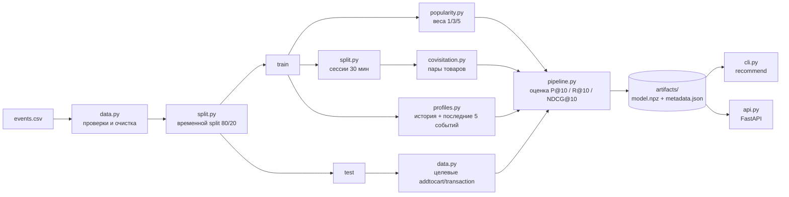

# Архитектура

## Поток данных

## Модули

| Модуль | Ответственность |
|---|---|
| `src/config.py` | Вариант, веса событий, пороги, все параметры эксперимента |
| `src/data.py` | Загрузка CSV, проверки схемы, очистка, целевые наборы test |
| `src/split.py` | Временное разделение, назначение `session_id` |
| `src/popularity.py` | Взвешенный популярностный baseline |
| `src/covisitation.py` | Симметричная co-visitation матрица в CSR-виде |
| `src/profiles.py` | CSR-профили: полная история и контекст последних событий |
| `src/recommend.py` | Top-N, фильтрация истории, fallback популярностью |
| `src/metrics.py` | Precision@k, Recall@k, бинарная NDCG@k |
| `src/pipeline.py` | Полный конвейер обучения, оценки и сохранения |
| `src/artifacts.py` | Формат `model.npz`, загрузка, выдача по visitorid/itemids |
| `src/cli.py` | Команды `train`, `evaluate`, `recommend`, `serve` |
| `src/api.py` | HTTP API (`GET/POST /recommend`, `/metrics`, `/health`) |

## Артефакты

`artifacts/model.npz` (npz без pickle) содержит:

* `popularity_item_ids`, `popularity_scores` — baseline;
* `covis_item_ids`, `covis_indptr`, `covis_neighbors`, `covis_scores` — CSR;
* `visitors`, `history_indptr`, `history_items` — история для фильтрации;
* `context_indptr`, `context_items`, `context_weights` — последние события;
* `test_visitors`, `test_indptr`, `test_items` — цели для повторной оценки.

`artifacts/metadata.json` — параметры, статистика данных, split, сессии,
метрики, пример выдачи. Файлы не коммитятся (`.gitignore`), потому что
модель детерминированно пересобирается из `events.csv`.

## Почему оценка не течёт

1. `train` и `test` разделены по времени, без перемешивания.
2. Популярность и co-visitation считаются только по train.
3. Для оценки контекст пользователя берётся строго до первого целевого
   события test; сами целевые события в контекст не входят.
4. `view` не является целью, а только контекстом.
5. `visitorid` используется только для выбора группы варианта
   (`% 30 = 15`), но не как числовой признак.
